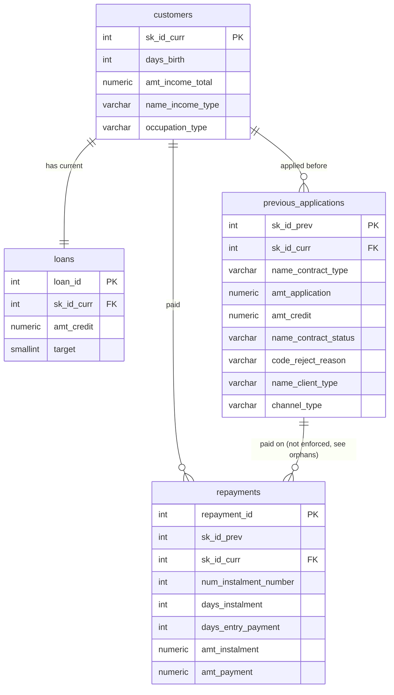

# Loan Approval and Repayment Behaviour Analysis (SQL)

A PostgreSQL project on Kaggle's [Home Credit Default Risk](https://www.kaggle.com/competitions/home-credit-default-risk) data. Instead of asking only "who defaults?", it looks at the lending process from a product angle:

1. **Who gets approved or refused, and why?**
2. **How do borrowers actually behave when paying back?**
3. **Does past behaviour (refusals, late payments) signal future default?**

About 14 million records across 4 tables, analysed entirely in SQL.

---

## Key Findings

- **The obvious underpayment query was wrong by more than 200x.** Row by row, 9.51% of payments looked underpaid. But 5% of instalments are paid in several parts, and each part looks "short" on its own. After combining parts per instalment, **99.96% of instalments were paid in full**; true underpayment was **0.04%**.
- **More applications are lost to the customer than to the lender.** 19.96% of past applications were cancelled or left unused, versus 17.36% refused. Over half of non-approved applications were not lender refusals.
- **Two channels hold about 90% of all abandonment.** Credit and cash offices (38.4% walk-away on 600,342 applications) and the contact center (41.5%). Corporate sales and AP+ have the opposite problem: high refusal (54.8% and 39.0%), little abandonment.
- **New customers are approved far more than repeat customers (93.4% vs 54.0%), and only part of that is product mix.** 89% of new-customer applications are consumer loans, the least-refused product. Adjusting for product mix explains roughly a third of the refusal gap; within the same product, repeat customers are still refused 2 to 4 times more often (consumer and cash loans).
- **Refusals are concentrated.** Three anonymised reason codes explain 92.3% of refusals; `HC` alone is 59.5%.
- **Approved amounts follow product logic.** Cash loans are never reduced and typically come out about 10% above the request; consumer loans are often slightly below it; revolving limits match the request 98% of the time.
- **Lateness is common but short.** 91.3% of instalments are paid on or before the due date, and 96.5% of late instalments are settled within 30 days.
- **Pricing lines up with behaviour.** Instalments on high-interest loans are paid late 13.4% of the time versus 7.8% for the lowest band, and 30+ days late 3.3x as often. Cash loans are paid late most often (12.2%).
- **Past behaviour signals default, and the signals stack.** Default rises from 7.07% (never refused) to 14.09% (refused 5+ times), and from 6.80% (never late) to 12.34% (late on over 25% of instalments). Customers with both warning signs default at 12.32%, twice the 6.11% of customers with neither. Overall default rate: 8.07%.

---

## Tech Stack

- **PostgreSQL 18** (pgAdmin 4, psql): schema, constraints, indexes, all analysis
- **Python** (standard library only): generates the staging SQL from CSV headers

SQL techniques used: CTEs, window functions (`SUM() OVER`, `PARTITION BY`, running totals, `RANK()`), `FILTER`, `CASE` bucketing, `PERCENTILE_CONT` (median), `LEFT JOIN` vs `JOIN`, `EXISTS` / `NOT EXISTS`, `CHECK` and `UNIQUE` constraints, indexes.

---

## Data

Three CSVs from the competition page (accepting the competition rules is required):

| File | Raw rows | Kept | Why rows were dropped |
|---|---|---|---|
| `application_train.csv` | 307,511 | 307,511 | none |
| `previous_application.csv` | 1,670,214 | 1,413,701 (84.6%) | belong to customers outside the training set |
| `installments_payments.csv` | 13,605,401 | 11,591,592 (85.2%) | belong to customers outside the training set |

---

## Database Design



**Two-layer load.** Raw CSVs are loaded as-is into `stg_*` tables with every column as `TEXT` (so the load can never fail on types), using `\copy`. Clean tables are then filled with `INSERT ... SELECT` and explicit casts. Some integer columns are stored as `-1134.0` in the CSV, so they need a two-step cast (`::numeric::integer`).

**Constraints.** 12 `CHECK` / `UNIQUE` constraints across the 4 tables (valid `target`, positive amounts, valid status values, negative day offsets, one loan per customer, and so on). Before adding them, a sanity query counted rule-breaking rows; all 14 checks returned 0.

**No foreign key from `repayments` to `previous_applications`**, deliberately. See the orphan check below.

---

## Data Quality

| Check | Finding | Decision |
|---|---|---|
| Payments without a matching application | **1,019,371 payments (8.8%)** across 32,699 loans and 29,748 customers reference loans missing from the application file. Confirmed against the raw file, so it is a source gap, not a load error | Keep them for payment analysis; no foreign key; note the gap when joining |
| Applications asking for 0 | 325,302 (23.0%), mostly cancelled cash loans (212,031) and revolving credit lines | Exclude from ask-vs-given comparisons |
| Missing term and instalment amount | 307,213 rows, all but 3 of them cancelled, refused or unused | Structurally missing (no schedule was set up); only analyse terms on approved loans |
| Placeholder codes `XNA` / `XAP` | Loan purpose missing for 95.8% of rows; yield group for 30.4% | Do not segment by purpose; channel and client type are usable |
| Reject reason vs status | Consistent: refusals carry real codes, approvals carry `XAP`, unused offers are always `CLIENT` | Unused offer is a customer decision, refusal a lender decision |
| Employment placeholder | `days_employed = 365243` for 55,374 customers (18.0%); occupation missing for 31.3% | Flag, do not use as real values |
| Lateness range | From 3,189 days early to 2,884 days late | Use buckets, not averages |
| Split payments | 553,925 of 11,026,627 instalments (5.0%) paid in several parts | Measure timing and underpayment per instalment, not per row |

`XAP` and `XNA` are interpreted as "not applicable" and "not available"; the dataset does not formally define them.

---

## Analysis

### Part A: The approval funnel (`previous_applications`)

**Q1. What happens to applications?**

| Outcome | Share |
|---|---|
| Approved | 62.68% |
| Lender refused | 17.36% |
| Cancelled or unused | 19.96% |

By client type, new customers were approved 93.4% of the time, repeat customers 54.0%. A product-mix breakdown showed 89.4% of new-customer applications were consumer loans versus 54.1% cash loans for repeaters. Applying new customers' refusal rates to the repeaters' product mix moves their refusal rate from 4.8% to about 10.4%, against 21.2% for repeaters, so product mix explains roughly a third of the gap.

**Q2. Why are applications refused?**
`HC` 59.5%, `LIMIT` 19.5%, `SCO` 13.3% (top three: 92.3%). Cash-loan refusals are dominated by `HC` (72.0%); consumer-loan refusals are spread across `LIMIT`, `HC` and `SCO`. Refusal rate by product: revolving 25.7%, cash 22.3%, consumer 10.3%. Reason codes are anonymised, so they are reported as codes.

**Q3. Which channels are refused or abandoned most?**

| Channel | Applications | Refused | Walked away |
|---|---|---|---|
| Credit and cash offices | 600,342 | 20.9% | 38.4% |
| Country-wide | 423,062 | 13.3% | 5.3% |
| Stone | 183,508 | 10.4% | 0.5% |
| Contact center | 58,891 | 21.8% | 41.5% |
| AP+ (Cash loan) | 49,624 | 39.0% | 6.5% |
| Corporate sales | 5,396 | 54.8% | 2.2% |

High-refusal channels point to a pre-screening problem; high walk-away channels point to a process or experience problem.

**Q4. Do customers get what they ask for?** (approved, both amounts above 0, 846,615 applications)

| Product | Got more | Got less | Exact | Median given / asked |
|---|---|---|---|---|
| Cash | 85.1% | 0.0% | 14.9% | 1.099 |
| Consumer | 32.7% | 52.0% | 15.3% | 0.995 |
| Revolving | 0.3% | 1.8% | 98.0% | 1.000 |

When consumer loans come in below the request, 84% of reductions are under 20%, which is consistent with a down payment (not confirmed by the data). Extras such as insurance are a plausible reason cash loans come out above the request.

### Part B: Repayment behaviour (`repayments`)

**Q5. How late do people pay?** (per instalment, using the final payment date)

| Timing | Share |
|---|---|
| Early | 67.20% |
| On the due day | 24.14% |
| 1 to 30 days late | 8.36% |
| 31 to 90 days late | 0.20% |
| 90+ days late | 0.10% |

**Q6. How often do people underpay?**

| Method | Underpaid |
|---|---|
| Row by row (naive) | 9.51% |
| Per instalment, parts combined | 0.04% |

The due amount is repeated on every part of a split payment, so the per-instalment version uses `MAX(amt_instalment)` for the amount due and `SUM(amt_payment)` for the amount paid.

**Q7. Does lateness differ by loan type and interest band?** (payments joined to their application)

| Loan type | Instalments | Early | On due day | 1 to 30 days late | 30+ days late |
|---|---|---|---|---|---|
| Consumer | 4,535,996 | 84.98% | 5.89% | 8.76% | 0.38% |
| Cash | 2,955,478 | 79.15% | 8.61% | 12.01% | 0.23% |
| Revolving | 2,537,855 | 34.59% | 60.40% | 4.81% | 0.20% |
| Not linked (orphan) | 994,715 | 33.75% | 61.03% | 4.78% | 0.44% |

Revolving loans are mostly paid exactly on the due day, a card-like rhythm. The orphan payments follow almost the same profile, which suggests the loans missing from the application file are mostly revolving or card-style accounts (a hypothesis; the data does not label them).

| Interest band | Instalments | Any lateness | 30+ days late |
|---|---|---|---|
| High | 2,275,630 | 13.38% | 0.53% |
| Middle | 2,475,281 | 10.19% | 0.25% |
| Low (normal) | 1,966,158 | 8.09% | 0.23% |
| Low (promotional) | 774,405 | 7.77% | 0.16% |

Lateness rises with the interest band, so the lender's pricing lines up with how borrowers later behave. Rows with an unknown band (`XNA`) are excluded.

### Part C: Past behaviour vs current default (all tables)

**Q8. Past refusals vs default** (one row per customer, `LEFT JOIN` keeps customers with no history)

| Refusal history | Customers | Default rate |
|---|---|---|
| No past applications | 16,454 | 5.96% |
| Never refused | 190,763 | 7.07% |
| Refused once | 46,534 | 8.83% |
| Refused 2 to 4 times | 41,502 | 10.88% |
| Refused 5+ times | 12,258 | 14.09% |

**Q9. Late-payment history vs default, and both signals together**

| Share of instalments paid late | Customers | Default rate |
|---|---|---|
| No payment history | 15,876 | 5.98% |
| Never late | 136,636 | 6.80% |
| Up to 10% | 75,587 | 7.88% |
| 10 to 25% | 48,694 | 9.93% |
| Over 25% | 30,718 | 12.34% |

| Refused before? | Late on over 10%? | Customers | Default rate |
|---|---|---|---|
| No | No | 159,550 | 6.11% |
| Yes | No | 68,549 | 9.40% |
| No | Yes | 47,667 | 9.90% |
| Yes | Yes | 31,745 | 12.32% |

---

## Mistakes I Caught

1. **Underpayment looked 200x worse than it was.** The row-level query said 9.51%. A data quality check had already shown 5% of instalments are split across several payments, so I recomputed per instalment: 0.04%.
2. **"40% got more than they asked for" was misleading.** The first count included 325,302 zero-amount applications, where any approved amount looks like "more". Restricting to fair comparisons (approved, both amounts above 0) gave the real split.
3. **New vs repeat customers looked like a loyalty story, but partly wasn't.** Checking product mix showed new customers mostly apply for the least-refused product. Standardising for mix explained about a third of the gap.
4. **Two `CASE` labelling bugs.** Copy-paste slips sent rows into the wrong bucket (a repeated `< 0.5` threshold, and a duplicated label). Both looked plausible; the clue was a bucket missing from the output. I now check that every bucket appears.
5. **Orphan payments: my load or the data?** I re-ran the orphan check against the raw staging table and got the same 1,019,371, confirming it was a source gap.

---

## Limitations

- **Correlation, not causation.** Refusal and lateness history are associated with default; the data cannot show they cause it.
- **Applications vs people.** Part A counts applications, so frequent re-applicants weigh more. Part C counts customers.
- **Survivorship.** Everyone in the data returned for a current loan; people refused early on and never returning are under-represented.
- **Anonymised codes.** Reject reasons (`HC`, `LIMIT`, `SCO`...) are not explained by the source, so they are reported as codes.
- **"Cancelled" may include process cancellations**, not only customer decisions, which is why it is described as "cancelled or unused".
- **Recorded instalments only.** Payments never recorded would not appear in the underpayment figures.
- **8.8% of payments** cannot be linked to an application record.

---

## Project Structure

```
loan-approval-repayment-analytics/
├── 01_schema/
│   ├── 01_create_tables.sql
│   └── 02_constraints.sql
├── 02_data_load/
│   ├── make_staging.py
│   └── 02_load_clean_tables.sql
├── 03_data_quality/
│   ├── 01_orphan_payments.sql
│   └── 02_data_quality_checks.sql
├── 04_performance/
│   └── 01_indexes.sql
├── 05_analysis/
│   ├── 01_approval_funnel.sql        # Q1 to Q4
│   ├── 02_repayment_behaviour.sql    # Q5 to Q7
│   └── 03_history_vs_default.sql     # Q8, Q9
└── README.md
```

## How to Run

1. Download `application_train.csv`, `previous_application.csv` and `installments_payments.csv` from Kaggle into one folder.
2. Create a PostgreSQL database.
3. Edit `folder` in `02_data_load/make_staging.py` (forward slashes, ending with `/`) and run `python make_staging.py`. It writes `01_staging.sql`.
4. In psql (or pgAdmin's PSQL Tool), connect to the database and run `\i 'path/to/01_staging.sql'`.
5. Run, in order: `01_schema/01_create_tables.sql`, `02_data_load/02_load_clean_tables.sql`, `01_schema/02_constraints.sql`, `04_performance/01_indexes.sql`.
6. Run any file in `03_data_quality/` or `05_analysis/`. They only read data; expected results are in comments under each query.
